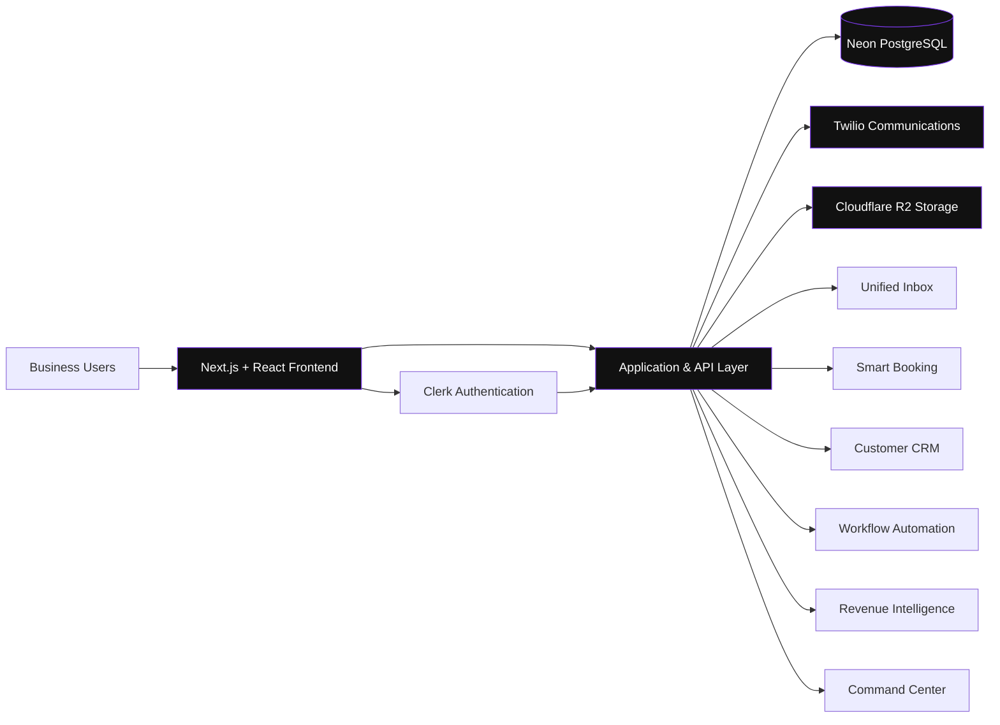

# Architecture Overview

> This document presents the conceptual public architecture for FlowDesk. It is intended to explain system design direction and does not expose private implementation details.

## System Overview

FlowDesk is designed as a multi-tenant SaaS platform where each account operates within scoped authorization and data boundaries. The frontend, application layer, and integrations coordinate to support communications, scheduling, customer management, and revenue operations.

## Frontend Architecture

The frontend is planned around Next.js App Router with React and TypeScript:

- Route-driven feature surfaces for inbox, booking, CRM, automation, and analytics views
- Shared UI/state patterns for account-scoped workflows
- Typed client/server boundaries for safer feature iteration

## Application and API Layer

The application layer is responsible for:

- Business logic and workflow orchestration
- Account-scoped authorization checks
- Integration orchestration with external providers
- Validation and consistency across customer, booking, and communication operations

## Authentication (Clerk)

Clerk is used for identity and session management, with tenant-aware access control enforced throughout application workflows. Authentication state is expected to inform account context used in downstream authorization decisions.

## Data Layer (Neon PostgreSQL)

Neon PostgreSQL is the primary relational data store for multi-tenant domain entities. Data design direction prioritizes:

- Tenant/account isolation
- Relational consistency for operational records
- Query patterns that support reporting and operational dashboards

## Communications Integration (Twilio)

Twilio supports communication channel integrations (for example, SMS workflows). The application layer mediates provider interactions so message processing remains consistent with account boundaries and audit requirements.

## Object Storage (Cloudflare R2)

Cloudflare R2 is used for file/object storage, such as attachments and related operational artifacts. Access patterns are expected to enforce authorization and avoid exposing raw storage paths publicly.

## Multi-Tenant Account Isolation

Tenant isolation is a core design requirement:

- Account context is carried through authentication and authorization flows.
- Data access is scoped at the account level.
- Integration actions are executed within tenant-specific boundaries.
- Operational visibility and analytics are account-scoped by default.

## Security Design Principles

FlowDesk architecture direction emphasizes:

- Least-privilege access control
- Defense-in-depth across authentication, authorization, and data access
- Secure handling of communication and attachment workflows
- Avoidance of sensitive configuration exposure in public artifacts

## Reliability and Maintainability

Design priorities include:

- Clear service boundaries between product areas
- Observable workflows for support and debugging
- Incremental feature evolution with documented architecture intent
- Consistent conventions that reduce operational complexity over time

## Conceptual Architecture Diagram

